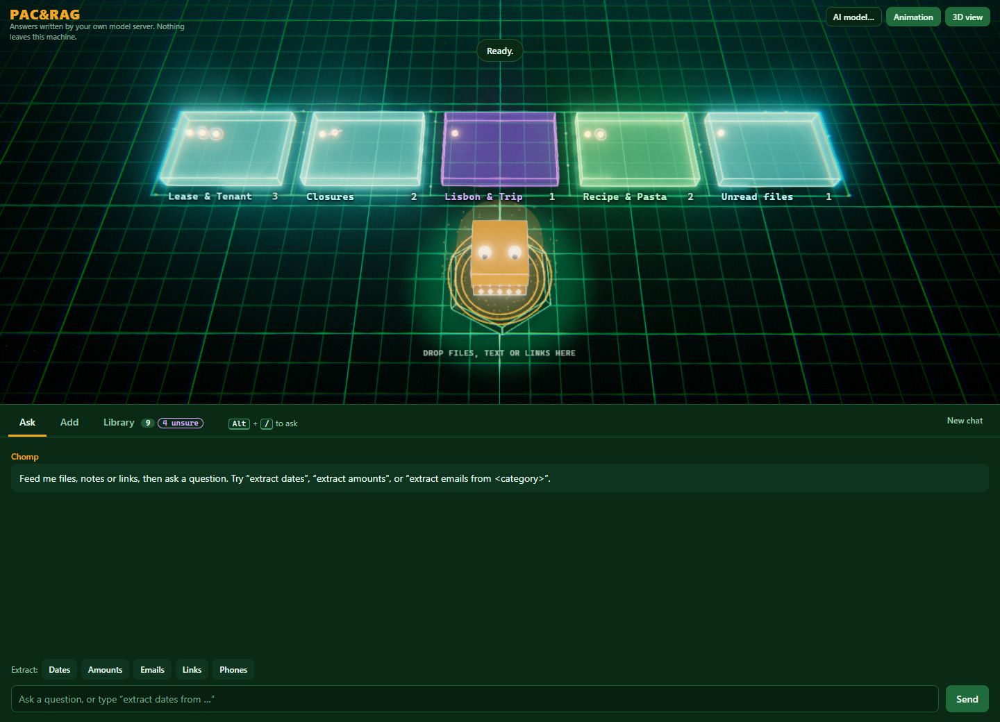
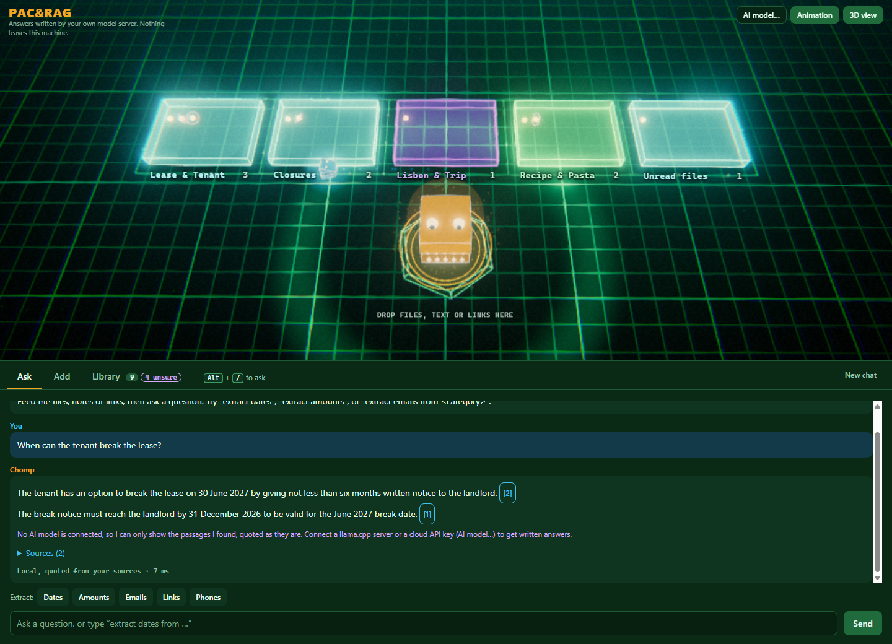
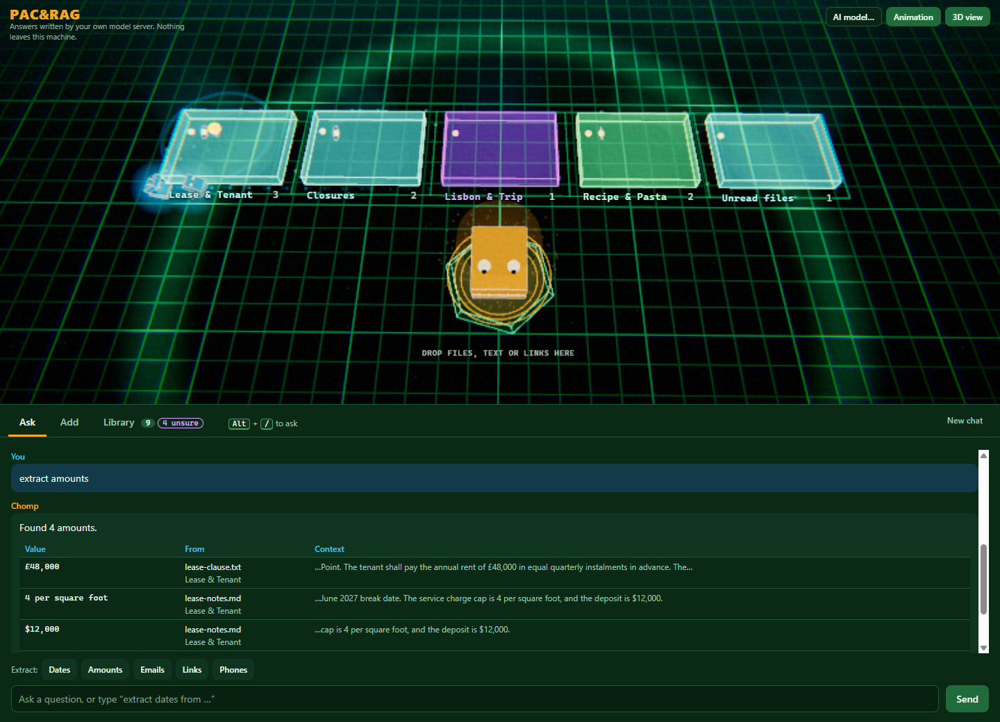
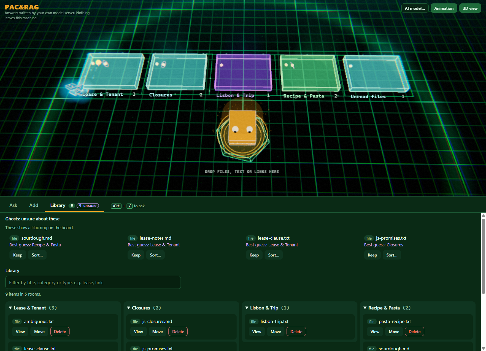
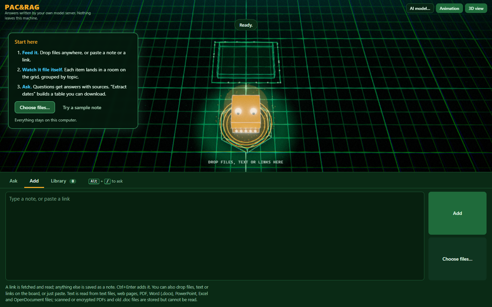
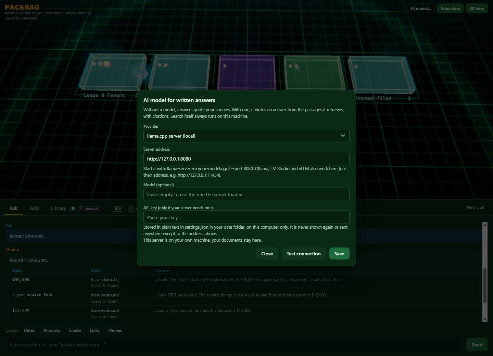
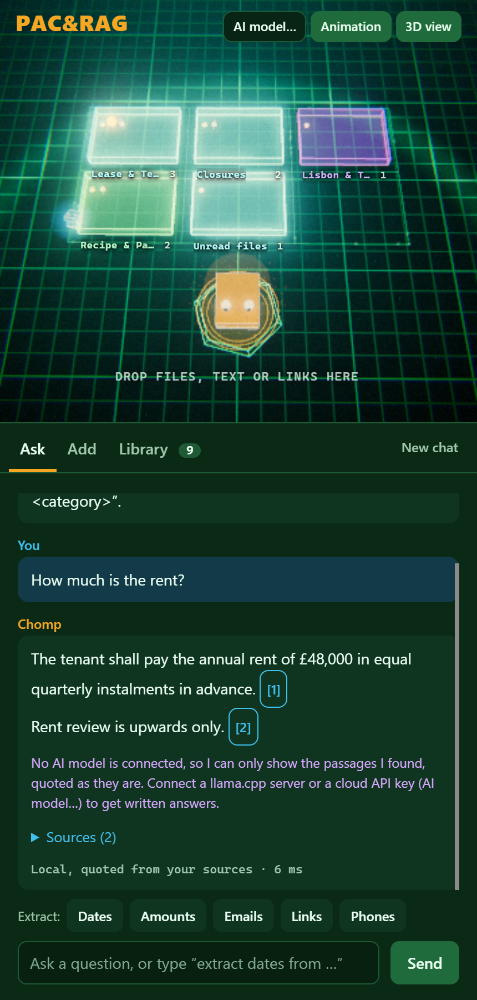
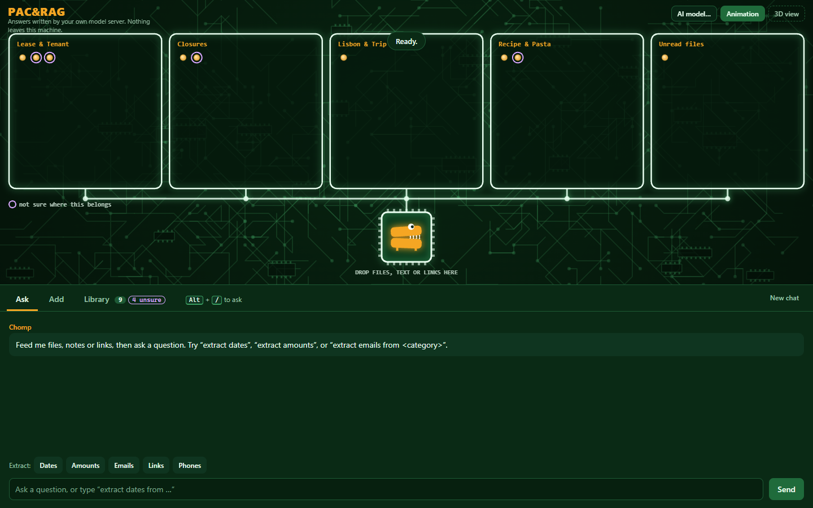
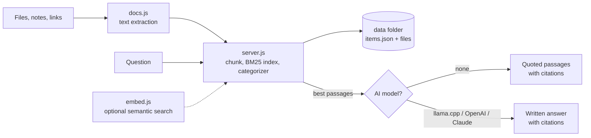

<div align="center">

# PAC&RAG

### Drop it in. Ask it anything. It never leaves your machine.

A local knowledge base with a circuit-board chomper for an interface.
Feed it files, notes and links. It reads them, files them into rooms, and answers your questions with the sources to prove it.




</div>

---

## Why PAC&RAG

Most "chat with your documents" tools want an account, a cloud upload and a pile of dependencies. PAC&RAG is the opposite: one folder, no install step, and the part that finds your answers runs entirely on your computer.

- **Drag, drop, done.** Files, pasted notes and links all go onto the board. Text is extracted, split into passages, indexed and filed under an automatically chosen category.
- **Answers that cite their sources.** Every answer carries `[n]` citations and a Sources list, so you can check where it came from.
- **Extract, don't just ask.** Type `extract dates`, `amounts`, `emails`, `links` or `phones` and get a table you can download as CSV.
- **Private by default.** The server listens on `127.0.0.1` only. Search, categorizing and extraction never leave your machine, and a language model is optional.
- **Zero runtime dependencies.** Plain Node. PDF, Word, PowerPoint, Excel and OpenDocument parsing is built in.
- **Honest when it does not know.** If nothing in your library supports an answer, it says so instead of guessing.

## See it work

### Ask a question, get quoted passages with citations



Retrieval is the "R" of RAG and always runs locally. Without an AI model connected, answers are the best-matching sentences from your own documents, quoted as written and numbered. Connect a model and it writes the answer from those same passages.

### Pull structured data out of anything



Dates, amounts, emails, links and phone numbers come back as a table with the file they came from and the text around each match. Add `from <category>` to scope it, and download the result as CSV.

### Your library, sorted into rooms



Categories are derived from their members, so moving an item teaches the categorizer. When it is unsure it files the item with a lilac ring and lists it under **Ghosts**: keep its guess, or sort it yourself.

### Start from nothing



A three-step card on first launch, a **Try a sample note** button, and paste-anywhere.

<table>
<tr>
<td width="62%" valign="top">

### Bring your own model, or none



Connect a local **llama.cpp** server (Ollama, LM Studio and vLLM work through the same interface), any **OpenAI-compatible** cloud API, or **Anthropic (Claude)**. The dialog tells you exactly which host would receive your passages.

</td>
<td width="38%" valign="top">

### Works on a phone-sized window



</td>
</tr>
</table>

### No WebGL? Flat board



The 3D view is chosen automatically when WebGL is available. Otherwise, or with `?view=2d`, you get this one. Everything on the board is also reachable from the lists and chat.

---

## Quick start

You need [Node.js](https://nodejs.org) 24. Nothing else.

```bash
git clone https://github.com/whos-json/pac-n-RAG.git
cd pac-n-RAG
node server.js
```

Then open <http://localhost:4747>. On Windows you can double-click `start.bat` instead.

```bash
node server.js --help   # usage and environment, without creating anything
npm test                # 151 tests, no network needed
```

> Do not open `public/index.html` from disk. The app needs the server, and a page opened as `file://` says so.

### Windows desktop app

The same app in its own window, no browser needed.

```bash
npm install        # once: Electron and electron-builder, dev-only
npm run app        # run it from source
npm run dist       # build dist/PAC-RAG.exe (portable, unsigned)
```

The exe is unsigned, so SmartScreen shows "More info, then Run anyway" the first time. Your library is stored in `PAC-RAG-data` next to the portable exe.

## What it does

| You do | It does |
|---|---|
| Drop or choose files, paste a note, paste a link | Extracts text, chunks it, indexes it (BM25), picks a category |
| Ask a question | Retrieves the best passages, answers with `[n]` citations, shows the sources |
| Ask a follow-up | Short follow-ups reuse your previous question for retrieval |
| Type `extract dates` / `amounts` / `emails` / `links` / `phones` (optionally `from <category>`) | Returns a table of matches with context, downloadable as CSV |
| Open the Ghosts list | Items it was unsure about: keep its guess or sort them yourself |

On the board, rooms are categories, pellets are items and the belly is the drop zone. The orange chomper digests what you drop and delivers a pellet to its room. When you ask a question the cyan chomper runs to the pellets that supplied the answer, so you can see which sources were used.

**Reads:** text and Markdown, web pages, PDF, Word (`.docx`), PowerPoint (`.pptx`), Excel (`.xlsx`) and OpenDocument (`.odt`, `.ods`, `.odp`). Scanned or encrypted PDFs and old `.doc` files are stored but flagged "no text extracted", never shown as gibberish.

**Keyboard:** <kbd>Alt</kbd> + <kbd>/</kbd> jumps to the question box, <kbd>Ctrl</kbd> + <kbd>Enter</kbd> adds a note. Every action has a keyboard path, results are announced through live regions, and `prefers-reduced-motion` turns the animation off.

## Privacy at a glance

| | |
|---|---|
| **Network** | Listens on `127.0.0.1` only. Rejects non-local `Host` headers (DNS rebinding) and requires a custom header on every write (cross-site posts). |
| **Your documents** | Stored in a local data folder. Categorizing, indexing, retrieval and extraction run locally. |
| **AI model** | Optional. Only the question, the few best passages (about 7,000 characters) and the last few chat turns are sent, never the whole library. |
| **API key** | Saved in plain text in `settings.json` in your data folder, never returned by the API, and only ever sent to the address it was saved for. Do not share or sync that folder. |
| **Kill switch** | `PACRAG_LOCAL_ONLY=1` never contacts any model, even a saved one. |

Links you add are fetched by the server from your machine, including addresses on your own network.

## Configuration

| Variable | Default | Meaning |
|---|---|---|
| `PORT` | `4747` | Port to listen on. Always bound to `127.0.0.1`. |
| `DATA_DIR` | `data/` next to `server.js` | Where the library lives. |
| `PACRAG_LLM_URL` | unset | Default llama.cpp / OpenAI-compatible server, for example `http://127.0.0.1:8080`. |
| `ANTHROPIC_API_KEY` | unset | Default Anthropic key. `CLAUDE_MODEL` picks the model. |
| `PACRAG_LOCAL_ONLY` | unset | `1`, `true` or `yes` forces local answers. |
| `PACRAG_EMBED_MODEL` | unset | Turns on optional semantic search, for example `nomic-embed-text`, via an Ollama-style server at `OLLAMA_URL`. |

The full table, with every variable, is in the [reference](docs/REFERENCE.md#environment).

## Architecture



| File | Role |
|---|---|
| `server.js` | HTTP API, storage, BM25 search, categorizer, extraction |
| `docs.js` | PDF, Office and OpenDocument parsing, no dependencies |
| `llm.js` | Written answers over plain `fetch`, settings, key redaction |
| `embed.js` | Optional semantic search, fused with BM25 |
| `workflow.js` | Item lifecycle as a finite state machine (`filed`, `review`, `unread`, `deleted`) |
| `main.js` | Electron wrapper for the desktop app |
| `public/` | The UI: 3D board (three.js, vendored), flat board, chat, library |

More in the [reference](docs/REFERENCE.md): privacy details, data handling, limits, design notes and known limits.

## Known limits

Worth knowing before you rely on it:

- **Keyword search by default.** Retrieval is BM25 with stemming, typo tolerance and a few synonyms. Without semantic search, "dentist" and "gym" are not known to both be health.
- **Local answers quote, they do not reason.** Connect a model if you want written answers that combine sources.
- **Categorizing groups shared vocabulary.** Short unrelated notes tend to get a room each, and room names can be blunt. Moving an item teaches it.
- **Extraction is pattern-based.** Ambiguous dates such as `03/04/25` are flagged, not guessed.
- **Large libraries.** The index is rebuilt after every change, so tens of megabytes of text can pause the server for about a second.
- **3D graphics were tested on a software renderer only,** not on a real GPU. Adaptive resolution is our stand-in for DLSS, not DLSS.

The complete list is in the [reference](docs/REFERENCE.md#known-limits).

## Development

```bash
npm test                                        # node --test, 151 tests
node uat/drive.js uat/readme-shots.json         # drive the real page in headless Chrome or Edge
```

The screenshots in this README are generated by `uat/readme-shots*.json` against the sample documents in `uat/corpus`, with no model connected. UAT notes are in [UAT.md](UAT.md).

## Trademark note

The mascot, "Byte" (a chip with a hinged lid, teeth and eyes), is an original character. The name PAC&RAG and the maze-with-pellets idea still echo Pac-Man, so check the name and branding with a trademark search before selling this.

## License

Not currently licensed for reuse (`UNLICENSED` in `package.json`). The vendored [three.js](public/vendor/three/LICENSE) is MIT.
